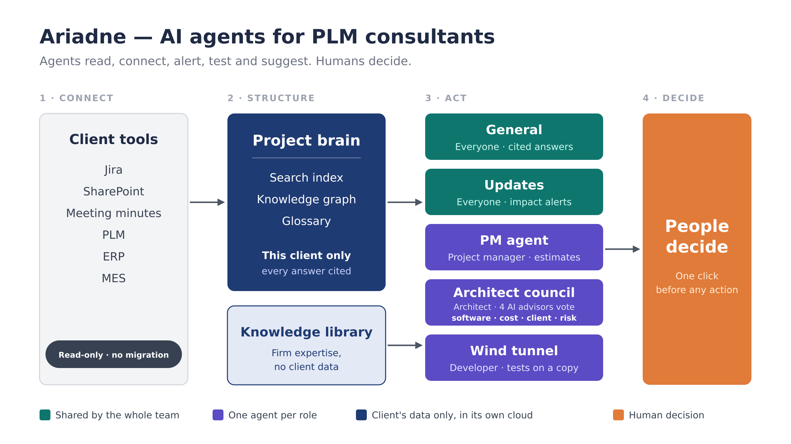
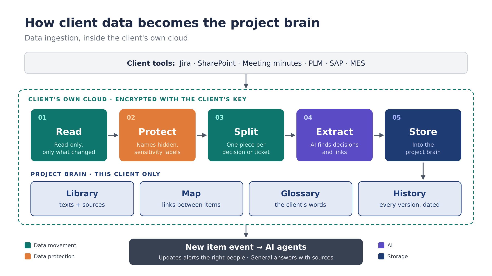

# Ariadne — AI agents for PLM consultants

**The thread through every PLM project.** A team of AI agents that works beside PLM consultants: it reads the whole project, connects the dots, alerts the right people and tests changes. Agents suggest; humans decide.

> 🏁 Designed in 48 hours at the **ESILV Data Protection & PLM Hackathon** (November 2026), with partners **Capgemini, Dassault Systèmes and Renault Group**. Team of 7.
> **My role:** co-proposed the AI-agents approach and designed the data ingestion architecture.
> This is a **design project**: the architecture is specified, and the demo shows the user experience on scripted data.

## Watch the 90-second introduction

INTRO_VIDEO_HERE

## The problem

PLM integration projects connect many systems (PLM, ERP, MES), teams and vocabularies, and they change constantly.

- A consultant needs **about a month** to understand a project they join.
- A decision made by one team (for example *"part descriptions limited to 40 characters"* in the ERP) **silently breaks** the PLM data model, interfaces and tests, and the problem surfaces late.
- Design trade-offs are made in meetings and **rarely recorded with their context**.

## The solution

One **project brain**, built only from the client's own data, and **five AI agents**:

| Agent | For | What it does |
|---|---|---|
| General | Everyone | Role-based onboarding and answers, always with sources |
| Updates | Everyone | Detects a change, follows the knowledge graph, alerts each person by impact |
| PM agent | Project manager | Turns a change into an estimate, plan update and status report |
| Architect council | Architect | Four AI advisors score the options and vote; the architect decides |
| Wind tunnel | Developer | Tests a fix on a copy of the project before deployment |

A **knowledge library** shares the firm's expertise across projects (methods and templates, never client data).

## Demo (3 minutes)

DEMO_VIDEO_HERE

*Same project, four consultants, four screens: onboarding in a day, an impact alert for the 40-character rule, the council's recommendation, and one decision updating every screen. Scripted data.*

## My role

### 1. Solution design
- Co-proposed the core idea: AI agents working on one shared project brain, each serving a different consultant role (project manager, architect, developer).
- Helped define what each agent does, and the rule that agents suggest while humans make the final decisions.

### 2. Data ingestion architecture
How client data becomes the project brain, inside the client's own cloud:

1. **Read**: read-only connectors to Jira, SharePoint, PLM and ERP; full history once, then only changes (webhooks, or a scheduled check comparing content fingerprints).
2. **Protect**: personal data pseudonymised (names → stable ID + role) and a sensitivity label added, before any AI reads the text.
3. **Split**: one chunk per ticket, decision or section; tables kept whole; each chunk tagged with source, date, version, roles and sensitivity.
4. **Extract**: an EU-hosted LLM fills a fixed JSON schema (decisions, attributes, links), validated, then matched to existing graph nodes.
5. **Store**: text in a search index, links in a knowledge graph, synonyms in a glossary, every version in the history. A *new item* event then wakes the agents.

## Tech stack

Qdrant + BGE-M3 (search) · Neo4j (knowledge graph) · Docling (parsing) · Presidio (pseudonymisation) · PostgreSQL (glossary, history) · Redis (queue) · LangGraph (agent orchestration, human approval steps) · FastAPI, React, Docker · EU-hosted or self-hosted LLM.

## What I learned

- In PLM, the hard problem is **links, not documents**: impact analysis needs a knowledge graph, not only a chatbot.
- **Data protection shapes the design**: retrieval instead of training is what makes deletion, access control and citations possible.
- Pseudonymised data is **still personal data** under GDPR; masking lowers the risk, it does not remove the obligations.
- AI earns trust through **sources and human checkpoints**, and by being honest about what is proven and what is a target.

## Team

Team 108 — Badr Agrad, Tristan Bincaz, Samuel Boyden, Zeineb Daly, Emma Johansson, Sabin Karn, Yassine Smach.
